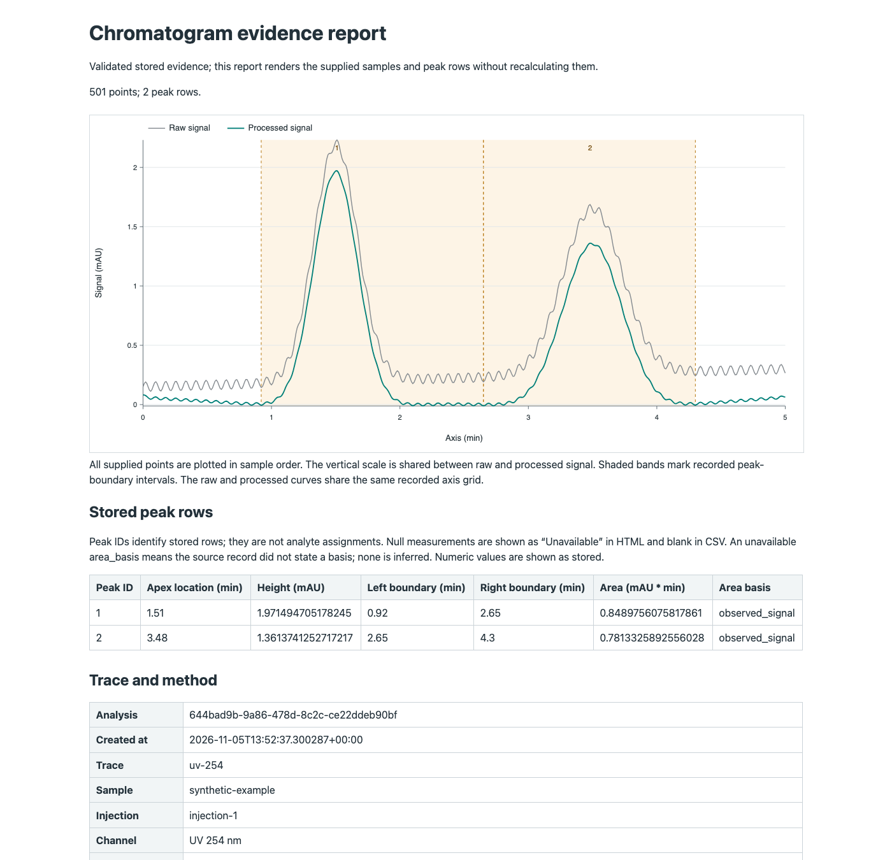

# Inspect a stored chromatogram and export its evidence

Retrieve an owned chromatogram analysis as a versioned evidence document,
then write an inspectable local report and exact numerical exports. Retrieval
uses stored results and does not repeat baseline correction, smoothing, peak
detection or integration. Reading and rendering an existing analysis need no
R worker. Creating a new analysis still uses the configured R backends.

Open the [representative report](reference-data/chromatogram-example/report.html)
or [standalone SVG](reference-data/chromatogram-example/chromatogram.svg).
The constructed two-peak example retains 501 raw and processed samples,
including 48 negative processed values, plus both recorded peak areas and
their `observed_signal` basis. The [publication receipt](reference-data/chromatogram-example/publication.json)
binds the files to the executed source and wheel. This is a processing and
export illustration, not a physical method qualification.



## Read the complete evidence through MCP

`measurement_get_chromatogram_evidence(analysis_id)` returns the
`measure-chromatogram-evidence/1` manifest: analysis/dataset/trace identities,
method, provenance, units, warnings, stored result metadata, explicit
availability, total point and peak counts, and an evidence SHA-256 digest.
It omits large point and peak arrays.

`measurement_read_chromatogram_evidence` reads `kind: "trace"` or
`kind: "peaks"` with a zero-based `offset` and `limit` from 1 to 1,000. Each
request includes the manifest's `evidence_sha256`, selecting that immutable
capture. Each
page repeats the analysis identity, whole-document digest, total row count and
next offset. Trace rows contain `sample_index`, `axis`, `processed_axis`, `raw_signal` and
`processed_signal`. Peak rows retain the fields actually stored by the
backend, including nullable areas or boundaries. A detection prominence is
included only when it was recorded. The backend's `area_basis` label is also
retained when supplied; a historical missing label is not inferred.

Both tools enforce analysis and dataset ownership. They accept no file path,
URL, executable code or output location. A missing or inaccessible record
produces an error. Evidence must have a matching source/method identity,
equal trace lengths and independently finite ordered axes, consistent peak boundaries and complete rows.
Unsupported analysis kinds are rejected rather than relabeled chromatograms.

The complete document is bounded to 50,000 points, 25,000 peaks and 16 MiB.
Each response page is bounded to 256 KiB. Smaller requested pages are useful
for clients with lower transport limits. The manifest and every page share
one content identity; clients must not combine pages with different digests.

Manifest retrieval validates and captures the document once. Page requests
decode only the requested rows from that immutable capture. Captures are
scoped to the resolved owner, database identity, analysis and digest. The
process retains at most four captures and 64 MiB of serialized capture data.
Cache eviction, database replacement or server restart requires an explicit
new manifest request. A failed partial collection writes no report; start a
new collection rather than appending pages to the old one. Captures are
temporary paging state, not a durable backup or general dataset snapshot.
HTTP paging requests must reach the same process; replicated routing is not
implemented for captures.

For an initialized MCP `ClientSession`, the provided collector reads all pages
and verifies complete coverage and the canonical whole-document digest:

```python
from measure_service.evidence_client import collect_chromatogram_evidence
from measure_service.evidence_report import write_report

evidence = await collect_chromatogram_evidence(client, analysis_id, page_size=500)
files = write_report(evidence, "/tmp/new-chromatogram-report")
```

The collector refuses changed identities, missing/reordered data and
inconsistent continuation pointers. It does not retry by creating a different
analysis. The evidence digest identifies the retrieved content; it is not a
signature or proof that historical stored data were never modified.

## Write a report from the local client

The [executable example](../examples/chromatogram_report.py) creates a
constructed two-peak trace in a temporary store, analyzes it through public
MCP tools and exports the complete evidence:

```sh
MEASURE_MCP_R=R python examples/chromatogram_report.py \
  --output-dir /tmp/new-chromatogram-report
```

To export an existing local analysis without reanalysis:

```sh
MEASURE_MCP_DATA_DIR=/path/to/local-store \
  python examples/chromatogram_report.py --analysis-id ANALYSIS_ID \
  --output-dir /tmp/new-existing-analysis-report
```

The output path is interpreted by this local client. It is not sent to the
MCP server and does not create an uploaded or managed asset. The example uses
the local stdio principal; it cannot retrieve another HTTP principal's records.
Output directories must be new. Existing files are preserved. Rendering is
bounded to 64 MiB across its five files and fails explicitly if that limit is
exceeded.

| File | Contents |
| --- | --- |
| `report.html` | Self-contained report with inline SVG, peak table, units, settings, provenance, warnings and availability |
| `chromatogram.svg` | Raw and processed traces with stored peak boundaries and peak IDs |
| `evidence.json` | Complete validated document with every source point, processed value and peak row |
| `trace.csv` | Every exact sample row, analysis/digest identity and axis/signal units |
| `peaks.csv` | Every stored peak row, analysis/digest identity, axis/signal units and area units |

The plot contains every sample without decimation. Raw and processed signals
share a vertical scale; negative values remain visible. Each trace uses its
exact recorded coordinate grid. The worker serialization can round an axis
coordinate by a floating-point step; both coordinates are retained rather than
rounded or interpolated to force a match. Peak boundaries are
the stored baseline locations. The report displays the integration-baseline
rule and the backend's area interpretation notes. It does not reconstruct an
unrecorded baseline curve or recalculate areas from the drawn overlay.

JSON retains numerical zeros and `null`. CSV numeric blanks mean unavailable,
not zero. Text cells that could be interpreted as spreadsheet formulas receive
an apostrophe prefix. XML-forbidden controls use visible Unicode escapes in
CSV and rendered labels; JSON retains their exact original text. Negative
numerical values stay numerical. CSV uses CRLF records and quoted multiline
text for compatibility across supported Python versions. HTML/SVG escape
source labels and contain no scripts or external resources.

## Interpret the evidence at its supported scope

Peak IDs identify detected signal rows. This view does not assign compounds,
link calibration children, deconvolve overlapping peaks or establish physical
qualification. Availability fields state those limits. A peak area is detector
response times the declared axis unit; it is not chemical purity or
concentration. A separate quantitative analysis may exist, but this report does
not silently attach it or infer an assignment.

This is the single-trace slice of [service #10](https://github.com/JamesHWade/measure-service/issues/10).
DAD/spectral heatmaps, MS evidence, component/residual overlays, failed
deconvolution displays, batch previews and annotation revisions remain open.
These reports are not a general portable dataset restore format or a batch
execution system.
