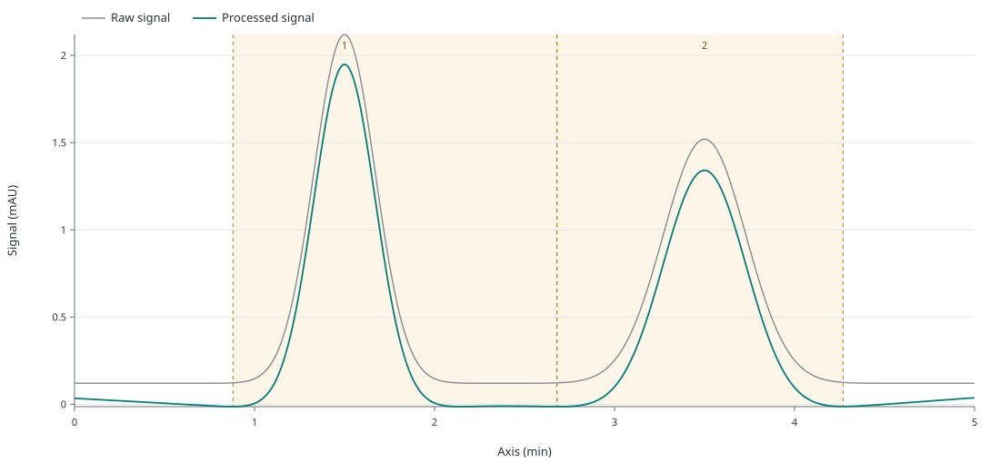

# Checked archive-to-fresh reproduction

Two archived chromatogram successes matched fresh R results: 4,020 numeric
comparisons and 1,018 exact categorical checks agreed, with zero observed
numeric error. The two originally unfinished source items remain unfinished
in the archived history.

Open the [results and downloads](reference-data/chromatogram-snapshot-example/index.html)
for trace previews, six individual reports, both archive modes and the
comparison policy. The [independent audit](reference-data/chromatogram-snapshot-example/independent-review.json)
records 308 artifact checks and 37 source probes.

## What was executed

The source is one synthetic wide CSV with five 501-point traces: 2,505 raw
points in the complete dataset closure. Four traces, totaling 2,004 points,
are selected with explicit reference, blank, QC and unknown roles. The fifth
trace remains unselected and is retained in the self-contained archive.

| Stage | Active batch | Historical analyses | Fresh analyses |
| --- | --- | --- | --- |
| Frozen source | Two completed, two pending | Two original successes | — |
| New-store import | Four pending | Two imported copies | Zero |
| Explicit fresh execution | Four completed | Two imported copies | Four new results |

The source history retains three attempts and two control events. A deliberate
R-start failure has unknown R runtime evidence. Cancellation and selected retry
leave the QC and unknown source items pending; later computations in a new
store do not rewrite those original outcomes.



The reference and blank provide the two supported numerical comparisons. Their
1,002 sample rows and stored peak rows were compared with absolute tolerance
`1e-10` or relative tolerance `1e-8`. Trace metadata, processing methods, sample
order, peak identities and categorical interpretation remain exact. Package
versions and code fingerprints are recorded separately from numerical equality.

The published comparison above reports its original run unchanged: it observed
zero numeric error under those tolerances. The current-backend replay test uses
the named `current-backend-replay/2` policy for a separate rerun. In that test,
only `processed_signal` has an absolute tolerance of `1e-9` and relative
tolerance of `1e-8`; the absolute tolerance is in mAU for this fixed reference,
whose signal unit is mAU, and is not a general guarantee for signals with other
scales or units. Peak height, area and prominence retain the historical
`1e-10` absolute and `1e-8` relative tolerances. Raw and processed axes, raw
signal, sample and peak identifiers, peak locations and bounds, counts,
methods, and categorical fields must match exactly. This replay policy does not
change the published comparison or its zero-error result.

The processed-signal allowance reflects a measured sparse-ALS replay: revision
`8ce4a3b` differed from the archive by at most `1.816e-10` mAU. Two of
1,002 samples exceeded the historical comparison budget. A fresh execution
with legacy revision `71894a6` matched the archive exactly. An independent QR
calculation agreed with the sparse solver within `2.204e-13` mAU after smoothing,
using the same seven ALS iterations and weights; the blank trace was unchanged. These implementation revisions and
runtime details are provenance for the recorded comparison, not backend pins or
general numerical guarantees.

Import retained original source text, mappings, methods, results, timestamps and
scientific provenance with new local dataset/analysis IDs and separate import
origins. Archived runs, attempts, controls and retry keys did not become active
execution authority. Four database hashes stayed unchanged during the
independent read-only audit of the original execution and its retained copy.

## Reproduce from the fixed archive

Use the compatible installed backends described in the [quickstart](quickstart.md).
The [complete workflow](batch-snapshot-example.md) generates a new source and
archive. To import this fixed reference directly, choose a new destination:

```sh
python -m measure_service.batch_restore \
  docs/reference-data/chromatogram-snapshot-example/output/source-self-contained.zip \
  --destination /tmp/measure-published-snapshot-restored
```

The [fixed-reference test](../tests/test_batch_snapshot_published_replay.py)
imports these exact retained bytes into a new store, performs four explicit
R-backed computations over public MCP, and compares only the two original
successes. The current-backend CI job runs this check without pinning R backend
revisions:

```sh
MEASURE_MCP_TEST_R="$(command -v R)" python -m pytest -q \
  tests/test_batch_snapshot_published_replay.py
```

The [execution record](reference-data/chromatogram-snapshot-example/execution.json)
identifies source `9d36526` and the installed wheel used for the retained run.
The [publication manifest](reference-data/chromatogram-snapshot-example/publication.json)
binds reference-file hashes to that execution. Content digests identify bytes;
they do not authenticate an archive's historical author.

This is a synthetic single-trace software qualification. Caller roles and peak
IDs establish no chemical assignment, purity, concentration or physical method
performance. DAD/MS processing, component/calibration revisions, full campaign
state restoration and MOCCA2 interoperability remain open under service #11.
