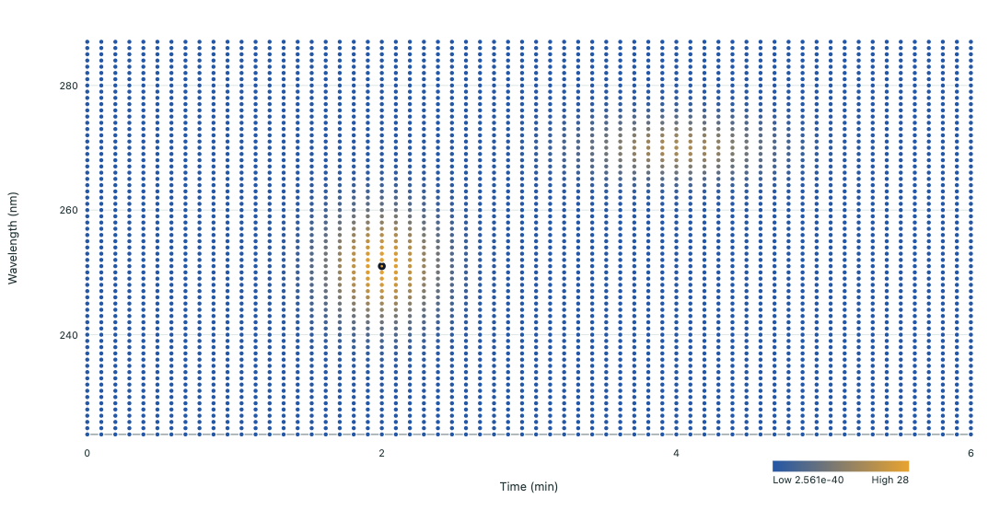
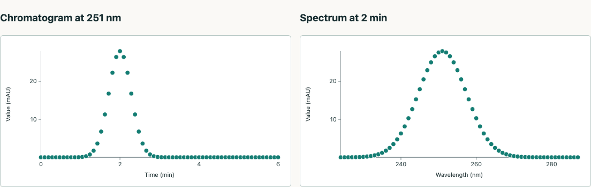

# Inspect a diode-array detector signal

A chromatogram answers how the response at one wavelength changes with time.
A spectrum answers how the response at one time changes with wavelength.
Select a point in the detector plane to read both slices and identify the
supplied observation behind them.

## Try two detector responses

From a service source checkout, generate a synthetic native acquisition with
the R package `measure`. The example assigns one source-row number to each
time–wavelength observation. Run the installed client with a local store
and a new output directory.

```sh
Rscript examples/make_dad_acquisition.R two-responses
measure-service-client dad two-responses --array dad-grid --time-axis 1 \
  --store study-store --output detector-report
```

Open `detector-report/report.html`. The map shows two regions of elevated response.



Inspect **2 min, 251 nm**. The selected
cell reads **28 mAU** (rounded), from source row **1372**. The chromatogram
shows 64 readings at 251 nm. The spectrum shows 64 readings at 2 min.
Change the selection to **4 min, 270 nm** to inspect the second response,
about **19 mAU**. The peak coordinates describe the synthetic signals.
Identifying a compound in a real sample requires additional evidence.



Each mark comes from one supplied observation. Time and wavelength use the
array's declared units. An axis can occupy either native dimension. Set
`--time-axis 2` when the second dimension carries time. Values are displayed
as supplied. A chromatogram uses one exact wavelength, with no band averaging.

## Check the slices in R

The native array and exported evidence can be read independently. For the
two-response example, these checks compare every coordinate and signal value
in the two selected slices.

```r
array <- measure::read_measure_acquisition("two-responses")$arrays$.measures[[1]]
points <- jsonlite::fromJSON("detector-report/evidence.json")$points
chrom <- subset(points, wavelength == 251)
spectrum <- subset(points, time == 2)
direct_chrom <- measure::measure_slice(array, wavelength = 251)
direct_spectrum <- measure::measure_slice(array, time = 2)

stopifnot(
  identical(chrom$time, direct_chrom$location),
  identical(chrom$value, direct_chrom$value),
  all(spectrum$wavelength == direct_spectrum$location),
  identical(spectrum$value, direct_spectrum$value)
)
```

## Inspect one region of a larger run

Repeat the simulation with 127 time points and 64 wavelengths. The resulting
8,128 observations exceed the whole-array read limit. To inspect the first
response, select 1–3 min and 245–255 nm.

```sh
Rscript examples/make_dad_acquisition.R dense-run --dense
measure-service-client dad dense-run --array dad-grid --time-axis 1 \
  --time-range 1 3 --wavelength-range 245 255 \
  --store study-store --output first-response
```

The selected region contains **473 observations**. At 2 min and 251 nm, the
28 mAU reading is native point **2716**. In this simulation its source row is
also 2716. The exported chromatogram contains the 43 readings at 251 nm from
1 through 3 min. The spectrum contains the 11 readings at 2 min from 245
through 255 nm. The region ends before the second detector response.

Use either range on its own to keep the full other axis. Equal endpoints
select one exact coordinate along that axis. The point limit counts matching
observations, including those with a missing signal. For an empty selection
the JSON still records both the bounds and the native point count.

## Read a sparse acquisition

The small test acquisition includes an absent coordinate, a missing response
and a saturation flag. Run the client from the source checkout.

```sh
measure-service-client dad tests/fixtures/native_dad_v1 --array dad-1 \
  --time-axis 1 --store study-store --output sparse-report
```

| Selection | What the native acquisition supplies |
|---|---|
| 0 min, 260 nm | No point row. Other wavelengths at 0 min and other times at 260 nm are still available. |
| 1 min, 260 nm | A point row with a missing value. Its source row is 104. |
| 1 min, 280 nm | A value of 50 mAU at source row 105, flagged as saturated. |
| 0 min, 280 nm | A value of 20 mAU with no source-row mapping. |

A source row is the one-based row declared by the acquisition writer. A
missing saturation flag means the acquisition did not supply a flag for that
cell. The export keeps this distinct from an explicit false.

## Reopen or share the evidence

Keep `report.html`, `points.csv` and `evidence.json` together. The CSV
preserves native point order. The JSON carries the input and evidence digests,
worker fingerprint, package versions and installed R code fingerprints. To
regenerate the report offline, give the installed client a new directory.

```sh
measure-service-client dad-report detector-report/evidence.json --output reopened
```

The reader verifies the evidence digest before export. A matching digest
checks consistency with the saved evidence. For a service client, register the
[bundle](inputs.md) and call `measurement_read_dad_plane` with its acquisition
ID, array ID and time-axis number. Registration and inspection use the `ms`
tool group. The plane reader uses `dad`. A single read accepts up to 4,096
selected points and 2 MB of canonical evidence.
