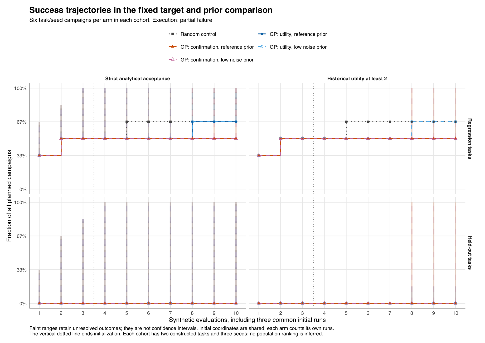
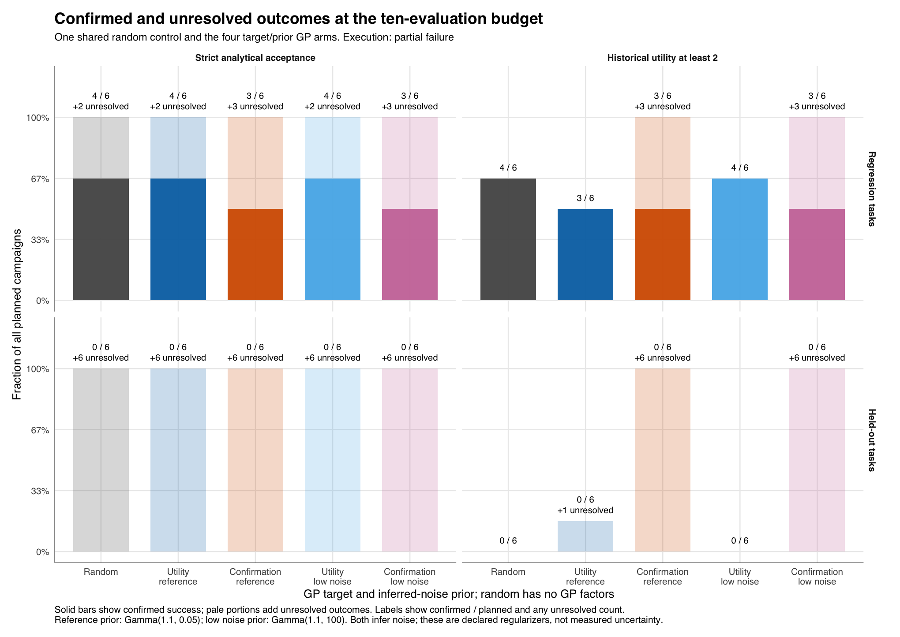

# The fixed target and prior study exposes a campaign-completion limit

The predeclared five-arm study recorded **543 of 600 planned evaluations**.
Nineteen GP campaigns stopped when the backend proposed a previously proposed
candidate. All 60 campaigns and 600 slots remain in the comparison; the 57
unexecuted slots remain unknown. There was no random fallback, task replacement
or post-result retuning. This is a recorded partial failure, not a completed
full-budget comparison.

On the regression cohort, random and both utility-target GP arms confirmed
strict acceptance in four of six campaigns. Both confirmation-target arms
confirmed it in three of six. None of the five arms confirmed strict success
on either held-out task. These fixed, small cohorts do not establish optimizer
superiority or prove that a held-out task is chemically inseparable.

## A frozen comparison with two separate criteria

The [study declaration](../src/measure_service/benchmarks/reference_data/synthetic-isocratic-ablation-v1.json)
was frozen before execution. It retains the two original constructed tasks as
regression cases and adds two independently generated, unfiltered held-out
tasks. Every task uses seeds 17, 29 and 43. All five arms share the three
initial coordinates within each task/seed block and count those evaluations
against their own ten-evaluation budgets. All 180 initial evaluations matched
the declaration. The original [120-evaluation experiment](synthetic-reference-results.md)
remains unchanged; it is a separate protocol/run and is not pooled here.

The four GP arms cross two factors: historical smooth utility versus a
confirmed-acceptance lower-bound reward, and reference versus low-noise Gamma
priors. Random is one shared control with no GP treatment. For the confirmation
target, an observed accepted assessment trains on 1; an observed not-accepted
or unknown assessment trains on 0. The analytical state stays unknown when
appropriate. Missing executions never become zero-valued training records.

The scalar RBF `SingleTaskGP` uses Gaussian regression and qLogEI. A binary
confirmation target under that model is a deliberately misspecified heuristic,
not a classifier or an estimated acceptance probability. Both priors infer
noise in standardized target units: Gamma(1.1, 0.05) versus Gamma(1.1, 100).
The latter is a regularization choice, not a measurement of physical noise.
See the [protocol](ablation-protocol.md) for definitions and boundaries.

## Success trajectories preserve unresolved outcomes



Each cell below reports **confirmed / unresolved** campaigns at the planned
ten-evaluation horizon, with six task/seed campaigns per arm and cohort.
An unresolved campaign is not an additional success or a confirmed failure.
For utility, a fully evaluated campaign with every finite score below 2 is an
observed no-success. A stopped campaign without earlier success stays unknown.

| Arm | Regression strict | Regression utility ≥2 | Held-out strict | Held-out utility ≥2 |
| --- | ---: | ---: | ---: | ---: |
| Random control | 4 / 2 | 4 / 0 | 0 / 6 | 0 / 0 |
| GP utility, reference prior | 4 / 2 | 3 / 0 | 0 / 6 | 0 / 1 |
| GP confirmation, reference prior | 3 / 3 | 3 / 3 | 0 / 6 | 0 / 6 |
| GP utility, low-noise prior | 4 / 2 | 4 / 0 | 0 / 6 | 0 / 0 |
| GP confirmation, low-noise prior | 3 / 3 | 3 / 3 | 0 / 6 | 0 / 6 |

For example, held-out utility `0 / 0` means zero confirmed successes and zero
unresolved campaigns: all six completed campaigns have observed no success.
Held-out strict `0 / 6` instead retains censoring or incomplete evidence in all
six campaigns. The two columns answer different questions.



Target contrasts hold the prior fixed; prior contrasts hold the target fixed.
A GP-versus-random contrast changes the joint policy. The published
[192 paired rows](reference-data/ablations/paired-comparisons.csv) retain each
task/seed pairing, and the [48 summaries](reference-data/ablations/paired-contrast-summary.csv)
separate regression, held-out and combined descriptive views. The shared
control is not replicated into independent samples. No significance test or
population ranking is inferred from these two-task cohorts.

## The partial execution is part of the result

| Arm | Budget-complete campaigns / 12 | Consumed / 120 | Duplicate stops | Recorded GP proposal wall time, s |
| --- | ---: | ---: | ---: | ---: |
| Random control | 12 | 120 | 0 | Unavailable |
| GP utility, reference prior | 11 | 117 | 1 | 479.659 |
| GP confirmation, reference prior | 3 | 93 | 9 | 334.043 |
| GP utility, low-noise prior | 12 | 120 | 0 | 498.474 |
| GP confirmation, low-noise prior | 3 | 93 | 9 | 334.298 |

Each stop occurred at zero-based ordinal 7, after seven consumed observations.
The registry rejected a duplicate before creating another analytical attempt.
All eighteen confirmation-target stops followed all-zero observed reward
histories; the utility-target stop followed nonconstant scores. This is an
observed failure condition, not a diagnosis of the backend's internal cause.
All 543 completed simulator attempts were consumed, with no completed orphan
attempts. The 543 declared synthetic evaluation cost units include the 180
initial evaluations. The remaining 363 comprise 84 later random evaluations
and 279 persisted GP proposals. Unexecuted slots incur no invented experiment
spend.

**The timing column covers the 279 persisted GP proposals only.** The 19
rejected suggestions have no persisted candidate or elapsed-time receipt, so
their timings are unavailable and excluded. Random generation time is also
unavailable. These are wall times, including process launches on a local shared
CPU; they do not support a speed ranking, and are not CPU or instrument time.
The tables retain declared acquisition duration and solvent volume for every
completed synthetic attempt, including censored observations. Neither quantity
is a physical measurement.

Two preflight attempts are retained separately from campaign spend. The first
performed all sixteen component cases successfully but the runner incorrectly
rejected valid unspecified acquisition defaults. It ran no analytical
campaigns. A validator correction preserved that failed receipt, its original
failure and 94.027 seconds, then a fresh sixteen-case gate qualified in 94.453
seconds. All-zero, all-one and mixed component histories returned finite
candidates under both priors; that component qualification did not establish
that every campaign could finish under its uniqueness policy.

[Service #45](https://github.com/JamesHWade/measure-service/issues/45) tracks an
explicit versioned duplicate/replicate policy and immutable failed-suggestion
telemetry. This recorded study will remain unchanged. A changed policy needs
its own declaration and qualification before another optimization comparison.

## Read the reference at its actual grains

- [600 evaluation slots](reference-data/ablations/evaluations.csv), keyed by
  `task_id`, `seed`, `arm_id`, `ordinal`. There are 543 consumed rows and 57
  unavailable future rows, with explicit execution and failure fields.
- [1,800 analyte slots](reference-data/ablations/analytes.csv), adding
  `analyte_id`. The 543 executions provide 1,629 analyte cases; the other 171
  planned analyte slots remain unavailable.
- [300 trajectory rows](reference-data/ablations/success-trajectories.csv),
  covering every arm, cohort, criterion and budget, with fixed denominators
  of 6, 6 and 12.
- [Export provenance and units](reference-data/ablations/metadata.json),
  [export seal](reference-data/ablations/complete.json) and
  [publication/build receipt](reference-data/ablations/publication.json).

The exporter copies recorded scalar evidence; it does not recalculate
retention, resolution, acceptance or reward. Prediction-stage values use
`prediction_*` fields and stay distinct from `gaussian_*` producer values.
A prediction cannot backfill a failed Gaussian observation. Missing numerical
values are empty, with explicit availability/status columns; known zero and
false values remain present. Units distinguish minutes, millilitres, seconds
and dimensionless resolutions/rewards.

The recorded local runtime used bo-engine 0.1.0, BoTorch 0.18.1, GPyTorch 1.15.2
and Torch 2.15.0. Source and setting evidence identify that execution without
restricting compatible installed revisions. The distribution's VCS fields are
null; the separate build receipt binds source commit/tree and wheel hash to
the sealed run rather than inventing distribution metadata. A different
software/device stack need not replay optimizer candidates bit for bit.

Independent numerical and accounting review passed **139,520 checks**, covering
all 543 evaluations, 1,629 analyte cases, 3,258 immutable generated results,
300 trajectory rows, 192 paired rows and 48 contrast summaries. Separate
70-digit Decimal calculations differ by at most 2.32e-15 minutes in retention,
1.24e-14 in resolution and 1.33e-14 in utility. There are no threshold-ambiguous
cases or classification/reward discrepancies. The
[machine-readable review](reference-data/ablations/independent-review.json)
retains declared tolerances, maxima and independently derived counts. A
separate projection audit matches every one of the 119,400 exported CSV cells;
both PNGs and independently rendered SVGs passed visual review. The full
evidence delivery includes the independent review scripts and outputs.

## Reproduce the tables and figures

First run the [fixed study command](synthetic-ablations.md). Check its reported
status and consumed counts: an atomic `complete.json` seals the exported
bundle and does not mean every campaign completed its budget. From the source
checkout or extracted source archive:

```sh
python scripts/export_ablation_reference.py /tmp/measure-ablation-report \
  --output-dir /tmp/measure-ablation-reference
Rscript scripts/plot_synthetic_ablations.R /tmp/measure-ablation-report
```

The exporter uses the Python standard library and the bundled declaration.
The plotter needs `ggplot2`, `jsonlite`, `digest` and a working R SVG device.
Both verify sealed inputs and refuse to overwrite existing outputs. Plot
publication validates all four staged PNG/SVG files before publication and
rolls back the invocation's outputs if publication fails, allowing a clean
retry. PNGs are 2040 × 1445; SVGs preserve the same verified values.

The full bundle retains immutable result chains, SQLite backup, both component
receipts and original failed-gate evidence. The source archive includes the
plotter, exporter, tidy references and figures. New executions receive new
record IDs and timestamps; compare tables by their logical keys.

These noiseless isocratic equations and assumed Gaussian widths do not qualify
physical retention fits, chromatographic traces, signal processing or an
instrument. Compoundwise surrogates, Matern kernels, manuscript mixture
filtering and multifidelity work remain in [#41](https://github.com/JamesHWade/measure-service/issues/41)
and the broader benchmark. This milestone provides an inspectable stress test
and exposes the next operational limit.
