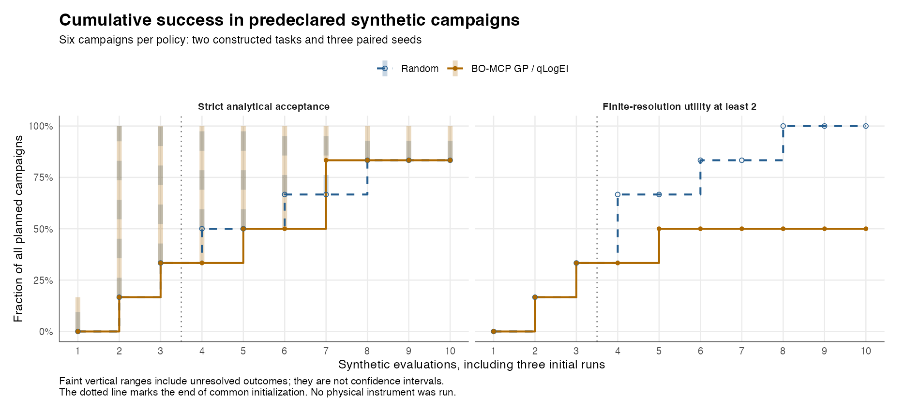
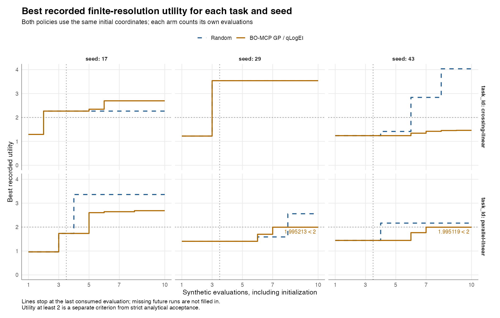

# Analytical acceptance and utility success diverge in the first synthetic comparison

Both policies found a strictly accepted method in five of six campaigns. Their
utility-threshold results differ: random sampling reached a source-profile
score of at least 2 in all six campaigns, while the scalar GP reached it in
three. Each policy has one analytically unresolved campaign. These are six
predeclared task/seed pairs, not a population estimate or a general ranking of
optimization algorithms.

All twelve campaigns completed their ten-evaluation budgets: 120 stored and
consumed simulator evaluations, including initialization, and 42 actual
BO-MCP GP suggestions. There were no execution failures or random fallbacks.

| At the ten-evaluation budget | Random | BO-MCP scalar GP / qLogEI |
| --- | ---: | ---: |
| Planned and completed campaigns | 6 / 6 | 6 / 6 |
| Strict analytical success confirmed | 5 / 6 | 5 / 6 |
| Strict success unresolved | 1 / 6 | 1 / 6 |
| Source utility at least 2 confirmed | 6 / 6 | 3 / 6 |
| Completed and consumed evaluations | 60 | 60 |
| Declared cost, synthetic evaluations | 60 | 60 |
| Simulated acquisition duration, min | 334.673 | 398.070 |
| Declared method solvent volume, mL | 167.337 | 199.035 |
| Recorded optimizer wall time, s | Unavailable | 258.461 |

The acquisition and solvent totals are declared synthetic method quantities;
they are not physical instrument time or measured solvent use. GP wall time
includes its child-process launches. Random-generation wall time was not
recorded, so it is not reported as zero.

## Success trajectories retain the whole planned cohort



The range from 5/6 to 6/6 for final strict acceptance expresses unresolved
evidence. It is not a confidence interval or an additional confirmed success.
Both arms count all three initial evaluations against their budgets.

## Two concrete disagreements explain why the criteria stay separate

For the parallel-slope task, GP seeds 29 and 43 produced accepted methods by
evaluation seven. Their best utilities are **1.995213** and **1.995119**, below
2. Both best-score methods acquire for ten minutes, above the declared
five-minute runtime preference. Critical resolutions of 1.5980 and 1.7665
exceed the strict 1.5 requirement, while the smoothed hierarchical utility
remains below its success cutoff. Rounding these scores to 2 would change the
campaign classification.

The converse occurs in random seed 43 for the same task. Evaluation four has
utility **2.166936**, but its critical resolution is **1.466037**, below 1.5;
that evaluation is analytically not accepted. The campaign's cumulative strict
state remains unresolved because other censored observations exist. A source
utility threshold is therefore not a substitute for the analytical contract in
either direction.



The GP arm has more accepted individual evaluations in this run, 17 versus 7,
and fewer censored analyte observations, 35 versus 60. Those evaluation-level
counts do not change the campaign-level result of five confirmed strict
successes each. Full-budget comparison, outcome definition and observation
grain all matter.

## Inspect the numerical reference

The public reference is split into two explicit grains:

- [120 evaluation rows](reference-data/synthetic-evaluations.csv), keyed by task,
  seed, policy and zero-based ordinal.
- [360 analyte rows](reference-data/synthetic-analytes.csv), adding analyte ID
  to that key. Censored times and unavailable resolutions remain empty, with
  explicit status columns.
- [Reference provenance and checksums](reference-data/synthetic-reference.json),
  including units, the exact frozen input, source tree, observed backend
  settings and the original complete-bundle file identities.

The recorded run used bo-engine 0.1.0, BoTorch 0.18.1, GPyTorch 1.15.2 and
Torch 2.15.0 on a local CPU runtime. Its GP uses the reviewed backend's RBF
default and inferred Gaussian noise. Source and version observations identify
this execution; they do not impose dependency revision restrictions or promise
bitwise optimizer replay across different software/device stacks.

Independent checks cover every retention/censor classification and incident
Gaussian resolution, all 120 scores and states, all 40 trajectory rows, all 12
paired rows and every evidence chain. Maximum absolute differences from the
independent calculations are 1.78e-15 minutes, 7.11e-15 resolution units and
4.89e-15 utility units. The score audit uses a separate 70-digit Decimal
calculation. The complete 120-row run also resumes from its existing store
with the optimizer runtime unset: evaluation tables, trajectories and SQLite
backup remain byte-identical, without new attempts or GP calls.

## Reproduce the figures and extend the study

Run the [fixed comparison command](synthetic-comparison.md) first. The plotter
checks every sealed core file before reading values and refuses to overwrite
existing figures. It uses `ggplot2`, `jsonlite`, `digest` and R's SVG device:

```sh
Rscript scripts/plot_synthetic_campaigns.R /tmp/measure-paired-synthetic-report
```

PNG and SVG exports share the same reviewed values. The source archive includes
the plot command, figures and both reference tables. New executions have new
record IDs and timestamps; compare numerical rows by their logical keys and
record the actual installed backend evidence.

These constructed, noiseless isocratic tasks are not the manuscript's filtered
50-mixture, three-segment study. The next comparison should predeclare whether
the target is strict acceptance, the historical utility or a manuscript-matched
profile, then vary objective, surrogate and policy choices separately. Physical
fits, processed signals, instruments and multi-fidelity execution retain their
separate requirements. The recorded result is preserved rather than retuned to
favor either policy.
