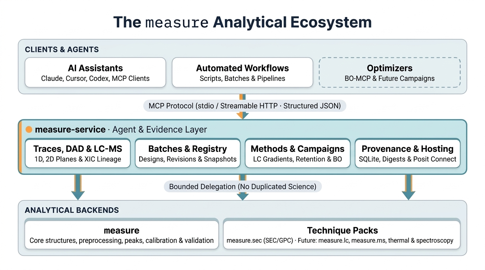

**`measure-service`** is the Model Context Protocol (MCP) service and evidence store for the [`measure`](https://jameshwade.github.io/measure/) analytical ecosystem. It exposes **82 structured MCP tools** across 12 workflow groups—covering scalar traces, native diode-array (DAD) planes, scan-linked LC–MS extracted-ion chromatograms, resumable analytical batches, chromatography method declarations, experiment lineage, and synthetic Bayesian optimization campaigns—while delegating scientific calculations to `measure` and its technique packs.

{.diagram-frame}

::: {.callout-note title="Status: research prototype"}
Local analytical workflows, native DAD/LC–MS inspection, resumable batches with portable snapshots, and bounded synthetic BO campaigns are tested. Hosted Posit Connect deployment is in pilot qualification ([issue #116](https://github.com/JamesHWade/measure-service/issues/116)), and direct instrument execution is not implemented.
:::

## Explore the documentation

::: {.grid}

::: {.g-col-12 .g-col-md-6}
### [Setup & MCP Clients](user-guide/quickstart.qmd)
Install the service, generate verified Claude Code or Codex settings with `measure-service-client`, and run built-in health checks.
:::

::: {.g-col-12 .g-col-md-6}
### [82-Tool MCP Reference](reference/mcp/index.qmd)
Browse auto-introspected JSON call signatures, parameters, and `.well-known/mcp.json` discovery metadata across all 12 tool groups.
:::

::: {.g-col-12 .g-col-md-6}
### [Traces, DAD, LC–MS & Batches](user-guide/dad-ms.qmd)
Inspect 2D diode-array planes, trace centroid XICs back to source scans, process chromatograms and relative SEC, and export portable batch snapshots.
:::

::: {.g-col-12 .g-col-md-6}
### [Registry, Methods & Campaigns](user-guide/experiments.qmd)
Track immutable design lineage, append-only attempt revisions, mapped CSV outcome tables, LC gradient methods, and synthetic BO-MCP campaigns.
:::

:::

## Try it in 30 seconds

::: {.panel-tabset}

### Install & verify

```sh
python -m venv .venv
.venv/bin/python -m pip install .
.venv/bin/measure-service-client check
```

Runs an installed stdio verification in an isolated temporary store: initializes two sessions, imports a synthetic trace, verifies retained digests across restart, and cleans up automatically.

### Generate client config

```sh
.venv/bin/measure-service-client config claude \
  --data-dir /absolute/path/to/private-measure-data

.venv/bin/measure-service-client config codex \
  --data-dir /absolute/path/to/private-measure-data
```

Prints safe, absolute-path MCP fragments for Claude Code (`.mcp.json`) or Codex (`config.toml`) without modifying your existing client files.

### Run an example workflow

```sh
.venv/bin/python examples/registry.py
.venv/bin/python examples/methods.py
```

Exercises experiment designs, attempt revisions, non-observed outcome states, and exact LC gradient solvent accounting against a temporary SQLite store.

:::

## The `measure` ecosystem

Scientific methods and data representations live in reusable analytical packages; `measure-service` owns the MCP tool boundary, durable evidence store, ownership isolation, and campaign orchestration.

| Package | Role |
| --- | --- |
| [`measure`](https://jameshwade.github.io/measure/) | Core measurement data structures (`measure_tbl`, `measure_nd_tbl`, `measure_record`, `measure_acquisition`), preprocessing recipes, peak operations, calibration, and analytical validation |
| [`measure.sec`](https://jameshwade.github.io/measure.sec/) | SEC/GPC technique pack (calibration, molecular-weight moments, distributions); future technique packs (`measure.lc`, `measure.ms`, thermal & spectroscopy) follow the same boundary |
| **`measure-service`** | 82 MCP tools, bundled `measure_methods` gradient accounting, SQLite evidence store, portable snapshots, Posit Connect hosting, and thin adapters to `measure` and its technique packs |

See [Ecosystem & Vision](user-guide/overview.qmd) and [Ecosystem Roadmap](user-guide/roadmap.qmd) for the unified multi-repository plan.

## Current scope

| Workflow | Available behavior | Main limit |
| --- | --- | --- |
| **Scalar traces** | JSON arrays; single, wide, or grouped-long CSV/TSV with explicit column/group mappings | 1D numeric traces; no vendor binary files |
| **Diode-array (DAD)** | Select time & wavelength cells across a whole plane or bounded region to read chromatograms, spectra, and source rows | Up to 4,096 observed cells per read |
| **Native LC–MS** | Extract centroid XICs and follow plotted points back to scans and contributing source rows | UTF-8 native acquisition bundle up to 4,000,000 bytes |
| **Chromatograms & SEC** | ALS baseline, Gaussian smoothing, peak integration, linear peak quantitation, relative SEC moments, and multi-run comparisons | No automatic compound ID, overlapping-peak deconvolution, or absolute MALS |
| **Analytical batches** | Frozen owned inputs, bounded parallel execution, cancellation/recovery/retry, portable snapshots, and new-store import | Single-trace processing; historical execution authority is not imported |
| **Method declarations** | Isocratic & linear gradients, exact solvent use, declared constraints, and immutable identities | No backpressure model, optimizer-domain sampling, or hardware control |
| **Experiment tracking** | Immutable design supersession, append-only attempt revisions, atomic CSV outcome tables, and evidence-linked corrections | Reported records; no physical execution control |
| **Retention & campaigns** | Ideal retention models (LSS/QSS/Neue–Kuss), analytical acceptance snapshots, latent Gaussian producers, and sequential synthetic BO-MCP campaigns | Single-fidelity latent reference; no general multi-fidelity or physical-instrument claim |

## Security & hosting

Records live in a single-node SQLite store (`measure.sqlite3`). Stdio mode uses one `local` principal. Hosted Streamable HTTP (`/mcp`) runs behind a trusted authentication proxy such as Posit Connect—parsing identity headers alone is **not** authentication. Read [Hosting, Connect & Store Ops](user-guide/deployment.qmd) before hosting.
