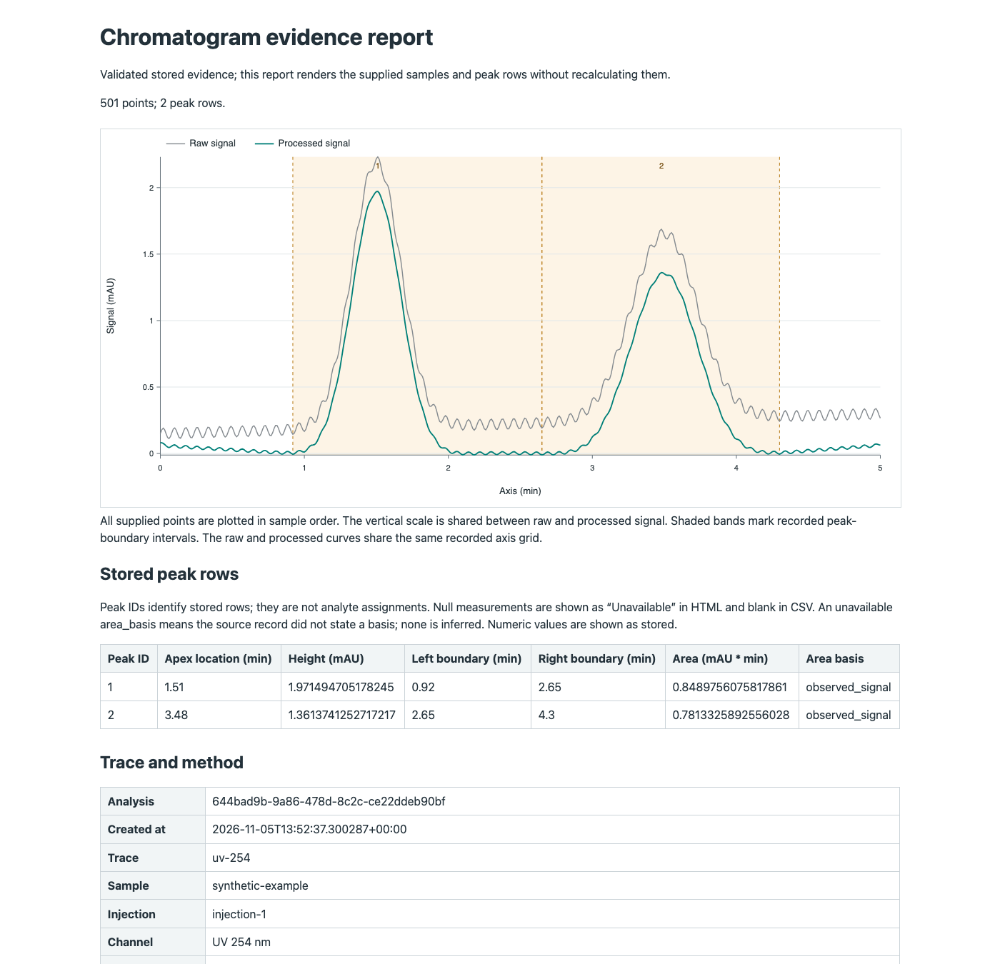

Analytical trace tools delegate numerical processing to the installed [`measure`](https://jameshwade.github.io/measure/) and [`measure.sec`](https://jameshwade.github.io/measure.sec/) backends inside a bounded 90-second subprocess while keeping MCP responses responsive and compact.

{.diagram-frame}

## Chromatogram processing and evidence inspection

[`measurement_analyze_chromatogram`](../reference/mcp/measurement_analyze_chromatogram.qmd) applies a bounded pipeline to one registered trace:

1. **Baseline correction:** `none` or asymmetric least squares (`als`).
2. **Smoothing:** `none` or Gaussian smoothing.
3. **Peak detection:** Controlled by minimum height, prominence, and minimum distance.
4. **Area integration:** Trapezoidal integration with `local`, `global`, or `none` baseline rules, plus explicit overlap diagnostics when neighboring peak boundaries touch or overlap.

::: {.callout-warning title="Index space vs. axis space"}
ALS baseline correction and Gaussian smoothing operate on **sample indices** (`smoothing_sigma` is in sample points), while `min_distance` and trapezoidal integration operate on the **declared elution axis**. On irregular grids, index-based preprocessing varies in physical width and the service emits an irregular-grid warning. See `docs/peak-settings.md` and `docs/peak-boundaries.md` for the reproducible ALS sampling-sensitivity study and overlap-warning contract.
:::

### Paging evidence and local reports

Analysis responses stay compact by design. To inspect full peak tables, processed traces, or SEC distributions:

- Use [`measurement_read_analysis_data`](../reference/mcp/measurement_read_analysis_data.qmd) (up to 1,000 rows and 48,000 compact UTF-8 bytes per page).
- Capture an immutable chromatogram evidence manifest with [`measurement_get_chromatogram_evidence`](../reference/mcp/measurement_get_chromatogram_evidence.qmd) and page it via [`measurement_read_chromatogram_evidence`](../reference/mcp/measurement_read_chromatogram_evidence.qmd) for reproducible offline HTML/SVG/CSV evidence reports.

## Linear peak quantitation

[`measurement_quantify_peak`](../reference/mcp/measurement_quantify_peak.qmd) calibrates one peak ID from a stored chromatogram analysis against caller-supplied response standards:

- **Model:** Linear fit with optional zero intercept and weighting of `none`, `1/x`, or `1/x2`.
- **Requirements:** At least three distinct concentration levels, strictly positive concentrations for inverse weighting, and a positive finite fitted slope.
- **Diagnostics:** Concentration estimate, slope, intercept, fit diagnostics, standard range, and an extrapolation warning outside the calibration range.

The caller declares chemical identity and affirms comparable integration, response units, and detector conditions. Dilution factors, internal-standard corrections, LOD/LOQ, and uncertainty intervals are not automatically applied by this tool.

## Relative SEC / GPC

[`measurement_analyze_sec`](../reference/mcp/measurement_analyze_sec.qmd) calculates conventional relative molecular-weight moments and distributions through `measure.sec`:

- **Input requirements:** Trace marked `separation: "SEC"` with `axis_unit` in `min` or `mL`, standards in `g/mol` with elution locations and description, plus an explicit caller assertion that the signal is baseline-corrected and proportional to weight concentration.
- **Calibration fit:** Linear ($\ge 2$ points), quadratic ($\ge 3$), or cubic ($\ge 4$) fit of $\log_{10}(\text{MW})$ vs. elution location.
- **Outputs:** Relative $M_n$, $M_w$, $M_z$, $M_p$, dispersity ($\text{Đ} = M_w / M_n$), calibration diagnostics, and differential/cumulative distributions.

::: {.callout-important title="Relative SEC is not absolute molecular weight"}
Reported SEC averages depend on the supplied standards, detector linearity, and integration domain. They are not absolute molecular weights, universal calibrations, or MALS fits.
:::

Use [`measurement_compare_sec`](../reference/mcp/measurement_compare_sec.qmd) to compare 2 to 8 distinct stored SEC analyses against the first, reporting numeric deltas alongside comparability flags for method digests, installed code fingerprints, and detector/channel/unit metadata.

## Provenance captured on every analysis

Every saved analysis records SHA-256 digests of the normalized input, method settings, and worker code (plus original delimited text digest when present), backend versions (including `measure`, `measure.sec`, and `Matrix`), installed code-database MD5 fingerprints, optional operator-declared revisions, and all warnings.
