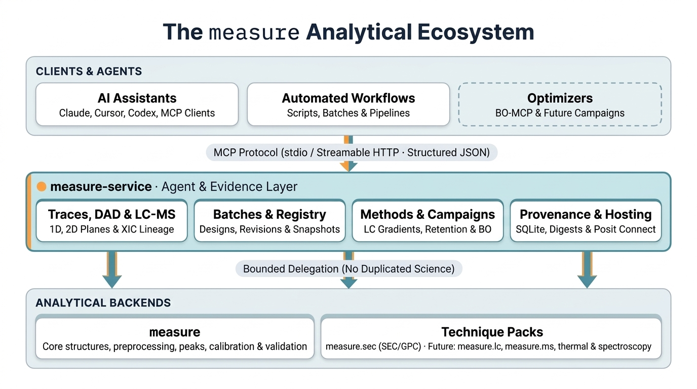

The MCP server validates tool arguments, resolves the caller principal, enforces per-principal ownership isolation, and stores canonical records in SQLite. Analytical trace, DAD, and LC–MS calls serialize bounded JSON to the packaged analytical worker (`worker.R`) delegating to `measure` and `measure.sec`, while chromatography method resource integration runs in the bundled `measure_methods` module shipped inside the `measure-service` distribution. Large arrays, exports, and original source files are always read in bounded pages.

{.diagram-frame}

## Security and execution posture

- **No arbitrary code, paths, or URLs:** No MCP tool accepts executable code, an arbitrary server file path, or a remote URL.
- **Packaged worker only:** The analytical worker path comes exclusively from the installed `measure_service` package.
- **Responsive bounded execution:** Analytical calls run in bounded 90-second worker subprocesses without blocking concurrent MCP control/read calls.

## Repository boundaries

| Component | Responsibility |
| --- | --- |
| [`measure`](https://jameshwade.github.io/measure/) | Core measurement data structures (`measure_tbl`, `measure_nd_tbl`, `measure_record`, `measure_acquisition`), preprocessing recipes, peak operations, calibration, and validation primitives. |
| [`measure.sec`](https://jameshwade.github.io/measure.sec/) | SEC/GPC calibration, molecular-weight moments, distributions, and detector calculations. |
| Future technique packs *(e.g., `measure.lc`, `measure.ms`, thermal & spectroscopy packs)* | Domain-specific analytical methods validated independently of an agent protocol. |
| **`measure-service`** *(including bundled `measure_methods`)* | 82 MCP tools, schemas, normalization, feasibility checks, immutable evidence records, batches/snapshots, synthetic campaign orchestration, SQLite storage, and Posit Connect hosting. |
| Optional BO runtime *(external)* | Surrogate models and acquisition functions invoked through bounded campaign adapters (e.g., optional BO-MCP runtime). |
| Client application *(external)* | User interaction, authenticated uploads, and policy decisions over tool outputs. |

::: {.callout-note title="No duplicated scientific implementations"}
Scientific algorithms belong in `measure` and its technique packs, never duplicated inside `measure-service`. Method resource integration stays cleanly separated in `src/measure_methods` with zero dependency on MCP, storage, or identity.
:::

## Package layout and CLIs

The installed distribution provides four command-line entrypoints:

| Command | Purpose |
| --- | --- |
| `measure-service` | Starts the stdio MCP server (or ASGI app `measure_service.server:app` for HTTP). |
| `measure-service-client` | Generates Claude Code / Codex MCP configs, runs installed stdio checks, and builds local DAD / XIC HTML reports. |
| `measure-service-store` | Operator store backup, SHA-256 verification, and exact restore tooling. |
| `measure-service-pilot` | Runs two-account pilot isolation, restart, and numerical qualification checks. |

Core source modules under `src/`:

- `src/measure_methods/`: Standalone LC gradient integration and design helpers (independent of MCP and storage).
- `src/measure_service/server.py` & `tool_catalog.py`: 82 MCP tools, 12 tool groups, and schema profiles.
- `src/measure_service/worker.R` & `dad_report.js`: Packaged analytical backend adapter and offline interactive DAD report asset.
- `src/measure_service/methods.py`, `method_registry.py`, `experiments.py`, `storage.py`: Method contracts, experiment/attempt/outcome registry, and canonical SQLite persistence.
- `src/measure_service/chromatogram_batches.py`, `observation_*.py`, `retention_*.py`, `campaign_*.py`: Resumable batches, portable snapshots, analytical acceptance, ideal retention, and synthetic BO campaign state machines.
