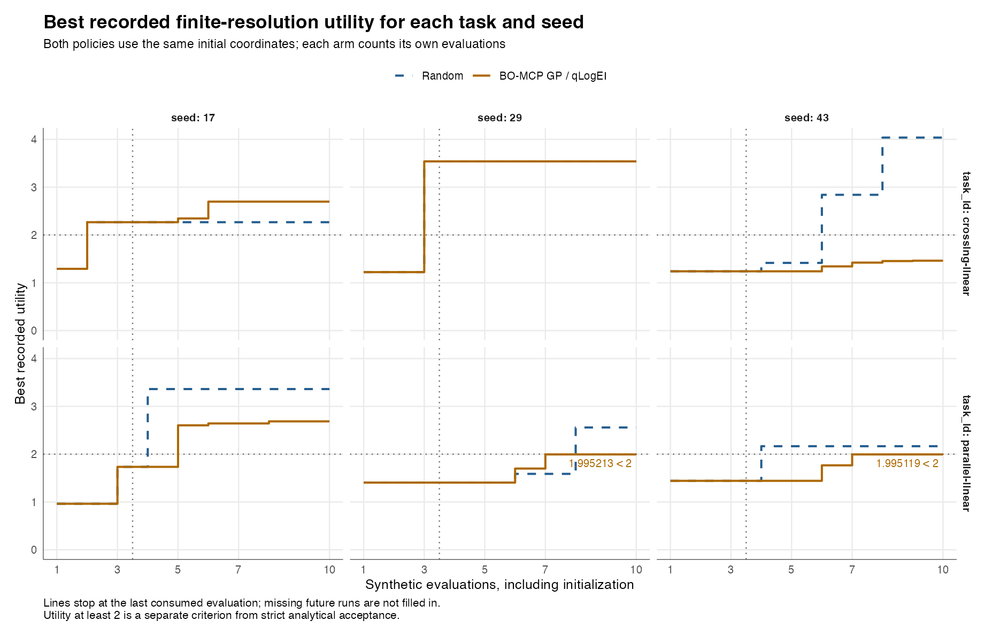
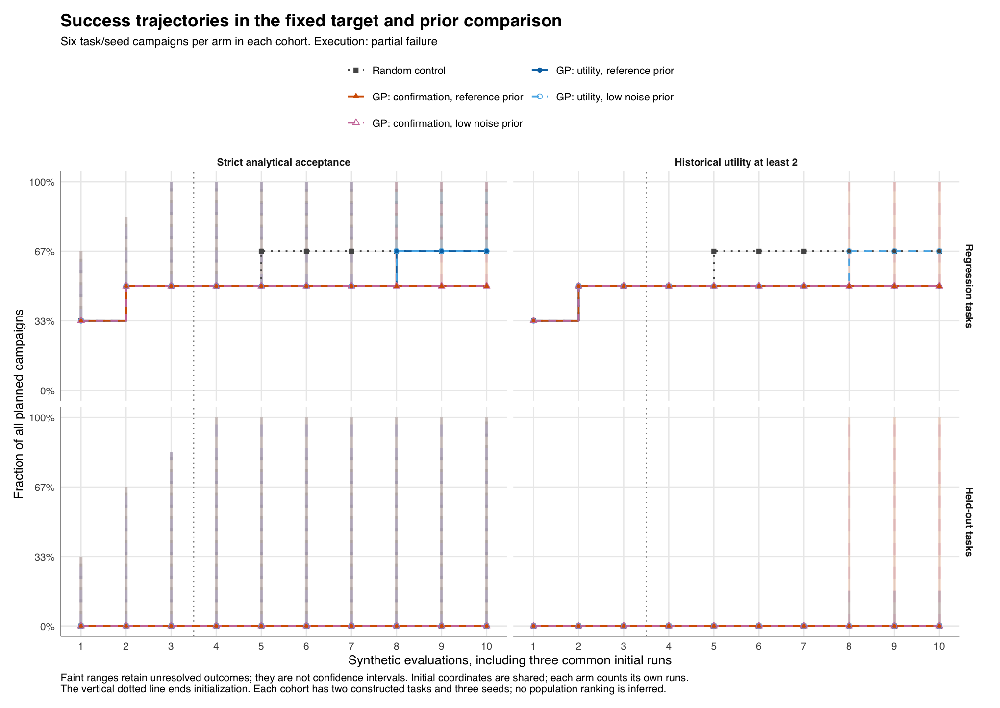

For chromatography method development, `measure-service` lets you predict retention times from declared ideal retention models, evaluate whether an analyte set meets resolution and runtime goals, and run reproducible synthetic Bayesian optimization loops. Simulated results stay strictly separate from physical lab runs.

{.diagram-frame}

## 1. Ideal retention models

Register declared ideal retention equations (linear `LSS`, quadratic `QSS`, or Neue–Kuss) with explicit natural-log coefficients, column geometry, dead time, and units via [`measurement_register_retention_model`](../reference/mcp/measurement_register_retention_model.qmd).

Predict ideal retention times for an owned constant-flow binary inlet method using [`measurement_predict_retention`](../reference/mcp/measurement_predict_retention.qmd), and retrieve immutable predictions with [`measurement_get_retention_prediction`](../reference/mcp/measurement_get_retention_prediction.qmd). Analytes that do not elute within the acquisition window remain explicitly censored, and ideal predictions make no physical peak-width, resolution, or instrument claims.

## 2. Analytical acceptance contracts and immutable snapshots

Before running experiments or campaigns, freeze the evaluation criteria:

1. **Declare the contract:** [`measurement_register_observation_contract`](../reference/mcp/measurement_register_observation_contract.qmd) fixes the required analyte cohort, analytical acceptance rules, and separate feasibility/runtime preferences.
2. **Evaluate exact attempts:** [`measurement_evaluate_observation`](../reference/mcp/measurement_evaluate_observation.qmd) assesses owned retention/resolution results against the contract, retaining three-valued analytical decisions (`pass`, `fail`, `unknown`) alongside separate evaluator origin and fidelity declarations.
3. **Freeze snapshots for optimizers:** [`measurement_create_observation_snapshot`](../reference/mcp/measurement_create_observation_snapshot.qmd) binds explicitly selected observation IDs and digests (at most one observation per physical attempt). Later result corrections or attempt revisions cannot mutate a frozen snapshot.

For controlled synthetic benchmarks, [`measurement_register_gaussian_producer`](../reference/mcp/measurement_register_gaussian_producer.qmd) and [`measurement_record_gaussian_observation`](../reference/mcp/measurement_record_gaussian_observation.qmd) generate reproducible latent Gaussian observations from an owned retention prediction and predeclared FWHM widths.

## 3. Durable synthetic BO campaigns

Campaign execution is fully auditable across restarts and failures:

1. **Freeze the protocol:** [`measurement_register_campaign_protocol`](../reference/mcp/measurement_register_campaign_protocol.qmd) locks matched task bindings, budgets, seeds, retention model, Gaussian producer, and observation contract before any arm runs.
2. **Create a campaign arm:** [`measurement_create_campaign`](../reference/mcp/measurement_create_campaign.qmd) starts one owned sequential task/seed/policy arm (all initialization consumes declared evaluation budget).
3. **Claim and finalize suggestions:** [`measurement_suggest_campaign`](../reference/mcp/measurement_suggest_campaign.qmd) durably claims a suggestion attempt, invokes the selected policy (including optional BO-MCP Gaussian-process suggestions in a separate runtime), and records exact training evidence, failure diagnostics, and timing. Same-key retries never re-run a claimed computation, and failed candidates are never silently replaced by fallbacks.
4. **Reconcile unresolved attempts:** Inspect suggestion attempts with [`measurement_list_campaign_suggestion_attempts`](../reference/mcp/measurement_list_campaign_suggestion_attempts.qmd) and explicitly reconcile interrupted claims via [`measurement_abandon_campaign_suggestion_attempt`](../reference/mcp/measurement_abandon_campaign_suggestion_attempt.qmd).
5. **Consume exact snapshots:** [`measurement_consume_campaign_snapshot`](../reference/mcp/measurement_consume_campaign_snapshot.qmd) atomically consumes one frozen complete observation for the pending proposal, updating budget, revision, and retry receipts while preserving analytical unknowns separately from source-profile utility.

{.diagram-frame}

::: {.callout-note title="Current scope of campaigns"}
The tested campaign stack covers single-fidelity matched synthetic protocols (including ablation studies and sequential qualification in `docs/synthetic-campaigns.md`, `docs/synthetic-ablations.md`, and `docs/campaign-runtime.md`). Broader caller-defined spaces, multi-fidelity physical-data refits, and instrument execution remain roadmap work.
:::
