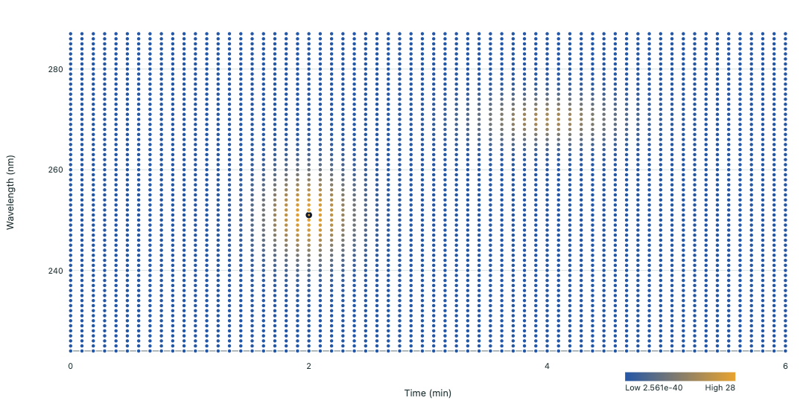
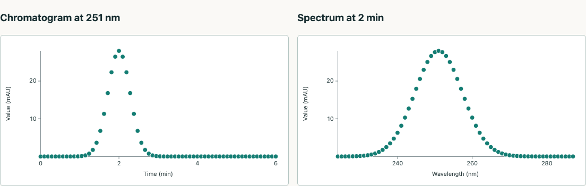
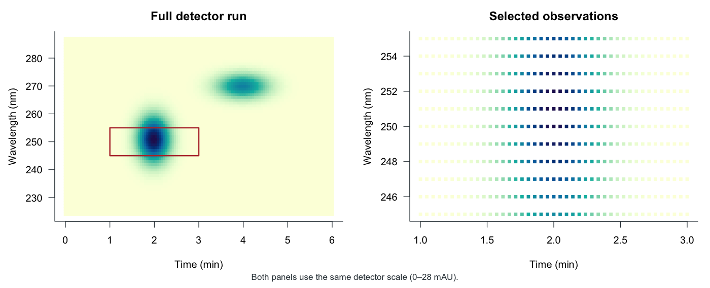

When working with photodiode-array (LC–DAD) or centroid mass spectrometry (LC–MS) data saved by `measure`, you can inspect 2D spectrochromatograms and extracted-ion chromatograms directly—and trace any plotted point back to its exact retention time, scan, and raw source row.

## Inspecting diode-array (DAD) planes

A chromatogram shows response vs. time at one exact wavelength; a spectrum shows response vs. wavelength at one exact time. Register a native acquisition with [`measurement_register_acquisition`](../reference/mcp/measurement_register_acquisition.qmd) and query its 2D plane via [`measurement_read_dad_plane`](../reference/mcp/measurement_read_dad_plane.qmd) (or generate an interactive local HTML report with `measure-service-client dad`):

```sh
Rscript examples/make_dad_acquisition.R two-responses
measure-service-client dad two-responses --array dad-grid --time-axis 1 \
  --store study-store --output detector-report
```

{.diagram-frame}

Selecting any cell in the detector plane exposes both the exact single-wavelength chromatogram (no band averaging) and the exact single-time spectrum, alongside the native point index, saturation flag, and contributing source row number:

{.diagram-frame}

### Zooming into bounded regions of dense runs

Whole-array reads are bounded to **4,096 observed cells**. For denser runs, supply inclusive `time_range` and `wavelength_range` bounds in the array's declared units—each point retains its original native point index and source row:

```sh
Rscript examples/make_dad_acquisition.R dense-run --dense
measure-service-client dad dense-run --array dad-grid --time-axis 1 \
  --time-range 1 3 --wavelength-range 245 255 \
  --store study-store --output first-response
```

{.diagram-frame}

## Scan-linked LC–MS extracted-ion chromatograms (XIC)

For native LC–MS centroid acquisitions, [`measurement_extract_ms_trace`](../reference/mcp/measurement_extract_ms_trace.qmd) sums centroid intensities within an inclusive `m/z` window for a declared `stream_id`, `polarity`, and `ms_level`, retaining both the scan-level trace and every contributing centroid row:

```sh
measure-service-client xic tests/fixtures/native_acquisition_xic_v1 \
  --stream ms-xic --polarity positive --ms-level 1 --mz-min 100 --mz-max 101 \
  --store ./ms-store --output ./ms-report
```

Inspect retained XIC metadata with [`measurement_get_ms_trace`](../reference/mcp/measurement_get_ms_trace.qmd) and page scan results or contributing centroids with [`measurement_read_ms_trace`](../reference/mcp/measurement_read_ms_trace.qmd).

::: {.callout-important title="Missing scans and saturated centroids stay explicit"}
- A **missing scan** leaves a gap in the plotted trace rather than inserting zero.
- An **acquired scan with zero matching centroids** records numeric `0`.
- A scan containing a **saturated selected centroid** marks the point unavailable while retaining all contributing centroid rows and source row numbers for inspection.
:::

Reopen any retained XIC report offline from the store by trace ID (verifying its SHA-256 digest before writing HTML, SVG, JSON, and CSV outputs):

```sh
measure-service-client xic-report "$TRACE_ID" --store ./ms-store --output ./ms-reopened
```
