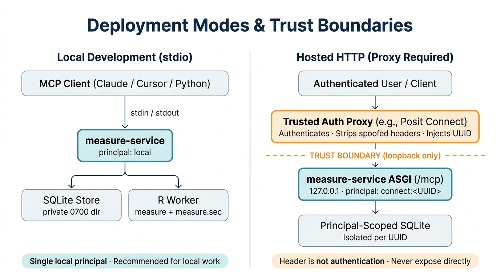

Local **stdio** is the primary development path. For shared deployments, `measure-service` exposes a Streamable HTTP ASGI app (`measure_service.server:app` at `/mcp`) designed to run behind a trusted authentication proxy such as **Posit Connect**.

{.diagram-frame}

## Key environment variables

| Variable | Default | Purpose |
| --- | --- | --- |
| `MEASURE_MCP_DATA_DIR` | `~/.local/share/measure-mcp` | Private directory containing `measure.sqlite3`. |
| `MEASURE_MCP_R` | `R` | Path to the `R` executable (not `Rscript`). |
| `MEASURE_MCP_TOOL_GROUPS` | all 12 groups | Optional JSON array limiting exposed tool groups (e.g., `["discovery","traces","evidence"]`). |
| `MEASURE_MCP_IDENTITY` | `local` | `local` for stdio, or `connect` for trusted proxy identity mode. |
| `MEASURE_MCP_TRUST_CONNECT_HEADERS` | unset | Must be `1` to accept Connect proxy identity headers. |
| `MEASURE_MCP_MEASURE_REVISION` / `MEASURE_MCP_SEC_REVISION` | unset | Optional operator-declared source revisions recorded in analysis provenance. |

## Identity modes and trust boundary

- **Stdio (`local`):** Uses a single `local` principal, so all clients sharing one `MEASURE_MCP_DATA_DIR` share that principal's records.
- **Hosted HTTP (`connect`):** Rejects `local` identity mode. Behind a trusted proxy, the service reads verified Connect caller identity (supporting Connect credentials / API visitor lookup) and scopes every read, write, batch, and capture to `connect:<UUID>`.

::: {.callout-warning title="Header parsing is NOT authentication"}
`measure-service` does not validate bearer tokens, OAuth grants, or cryptographic header signatures on its own. A trusted reverse proxy **must** authenticate callers, strip caller-supplied identity headers, inject verified identity, configure allowed public `Host`/`Origin` authorities (see `docs/http-authorities.md`), and prevent direct network access to the loopback process.
:::

## Hosting on Posit Connect

`measure-service` includes a dedicated Connect bundle builder (`scripts/build_connect_bundle.py`) that stages a self-contained `python-fastapi` bundle (`app.py`, pinned `requirements.txt`, hashed wheel, and optional `manifest.json` for `measure` / `measure.sec` packages):

```sh
python scripts/build_connect_bundle.py \
  --pins pins.txt \
  --python-version 3.12.10 \
  --r-manifest path/to/r-manifest.json \
  --r-requires '>=4.5.0' \
  --output build/bundle
```

Before inviting external researchers to a hosted instance, complete the qualification checklist in `docs/pilot-readiness.md`, run `measure-service-pilot` two-account checks (`docs/pilot-client.md`), and record live host evidence (`docs/pilot-host-record.md`, tracked in [issue #116](https://github.com/JamesHWade/measure-service/issues/116)).

## Store operations, backups, and read-only access

SQLite (`measure.sqlite3`) is a single-node persistent store:

- **Permissions:** Newly created data directories use mode `0700`. Always point `MEASURE_MCP_DATA_DIR` at a private persistent directory, never a shared temporary path, for real measurements.
- **Verified backup & restore:** Use `measure-service-store` (see `docs/store-recovery.md` and `docs/store-recovery-example.md`) to take consistent backups, verify digests, and test exact restoration into a separate directory.
- **Read-only inspection:** Existing stores can be opened in read-only mode without creating or migrating tables (`docs/read-only-store.md`).
- **Capture retention:** Temporary export and evidence captures are owner-isolated and bounded (`docs/capture-retention.md`).
- **Project sharing & deletion (design stage):** Runtime records are currently single-owner. The proposed actor/project sharing and tombstone/purge model is documented in `docs/project-sharing-design.md` and tracked in [issue #105](https://github.com/JamesHWade/measure-service/issues/105).
