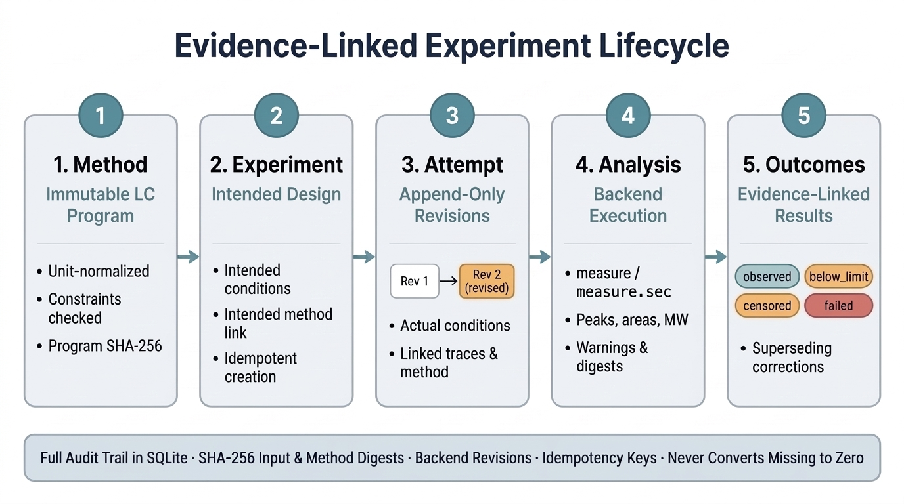

The experiment registry is the local system of record for immutable experimental designs, design replacement lineage, append-only attempt revisions, mapped CSV outcome tables, and evidence-linked results.

{.diagram-frame}

## 1. Experiments and design lineage

- **Create:** [`measurement_create_experiment`](../reference/mcp/measurement_create_experiment.qmd) records an immutable intended design: title, caller-declared `source`, `intended_conditions` (finite numeric values with explicit units such as `"mL/min"` or `"1"`, plus unit-free categorical/boolean values), and optional `executable_method_id` or external references.
- **Supersede without rewriting history:** [`measurement_supersede_experiment`](../reference/mcp/measurement_supersede_experiment.qmd) replaces only a current owned design with a complete new immutable experiment using an `expected_input_sha256` optimistic check and `reason`. Historical attempts, observations, snapshots, and campaign evidence keep their original experiment IDs.
- **Inspect lineage:** [`measurement_get_experiment_design_lineage`](../reference/mcp/measurement_get_experiment_design_lineage.qmd) returns verified ordered design versions and the current pointer.

## 2. Attempts and append-only revisions

Record each physical run with [`measurement_record_attempt`](../reference/mcp/measurement_record_attempt.qmd) and update records via [`measurement_revise_attempt`](../reference/mcp/measurement_revise_attempt.qmd):

- Captures `actual_conditions`, separately reported `executable_method_id`, reported status (`planned`, `running`, `completed`, `cancelled`, `failed`, or `unknown`—the last three require explanations), UTC-normalized timestamps, owned dataset/trace links, replicate identifiers, and caller-declared evaluator metadata (`manual`, `instrument`, `simulator`, `replay`, optional `fidelity` in $[0, 1]$).
- Revisions require `expected_revision`, a full replacement specification, a `reason`, and a fresh `idempotency_key`. Earlier revisions remain readable via [`measurement_get_attempt`](../reference/mcp/measurement_get_attempt.qmd).
- Use a **revision** to correct a record; create a **new attempt** for a separate physical run or injection.

## 3. Outcomes and evidence links

Record outcomes atomically against an exact `expected_attempt_revision` with [`measurement_record_results`](../reference/mcp/measurement_record_results.qmd):

| Status | Value or bounds | Meaning recorded |
| --- | --- | --- |
| `observed` | Finite number (including `0`) | Reported numeric observation |
| `not_detected` | None | Caller reports no detection |
| `below_limit` | `upper_bound` only | Caller reports value below a declared limit |
| `censored` | At least one bound (`lower < upper` if both) | Caller reports a bounded interval |
| `missing` | None | Result unavailable |
| `failed` | None | Measurement or evaluation failed |
| `infeasible` | None | Caller reports infeasibility |

::: {.callout-important title="Non-observed outcomes are never converted to zero"}
Every non-observed outcome requires an explicit `explanation`. For `observed` outcomes, supply either a manual numeric `value` (`caller_reported`) or an owned `analysis_id` + direct numeric `summary_field` (`stored_analysis_summary`), which copies the stored number, warnings, and backend provenance verbatim.
:::

One current outcome head exists per `(attempt_id, metric, analyte_label)`. Corrections supply `supersedes_result_id` and an explanation while preserving the superseded record.

## 4. Atomic CSV outcome tables

For multi-attempt result spreadsheets or lab exports:

1. **Preview without writing:** [`measurement_preview_result_table`](../reference/mcp/measurement_preview_result_table.qmd) parses explicitly mapped CSV rows without mutating state or inferring values/statuses.
2. **Import atomically:** [`measurement_import_result_table`](../reference/mcp/measurement_import_result_table.qmd) commits mapped outcomes across owned attempt revisions in a single SQLite transaction, retaining exact source-row coordinates and original UTF-8 CSV bytes.
3. **Audit provenance:** Read the import receipt with [`measurement_get_result_table_import`](../reference/mcp/measurement_get_result_table_import.qmd), page row-to-result bindings with [`measurement_read_result_table_rows`](../reference/mcp/measurement_read_result_table_rows.qmd), and page exact base64 source bytes with [`measurement_read_result_table_source`](../reference/mcp/measurement_read_result_table_source.qmd).

## Registry bounds & idempotency

Every registry write requires a principal-scoped `idempotency_key`; repeating the exact normalized request returns its original response, while reusing a key with different arguments fails. Limits are 64 conditions per set, 32 measurement links per attempt, 50 outcomes per batch, 50 records per list page, and 64,000 UTF-8 bytes per serialized record/request.
