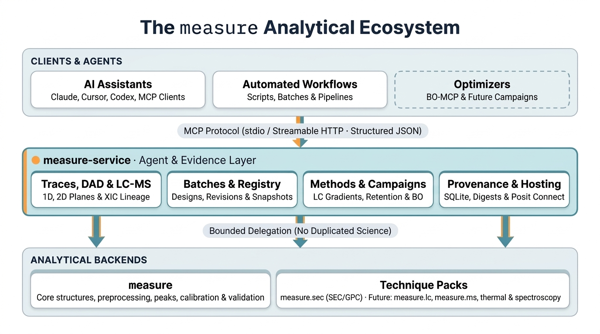

`measure-service` connects AI assistants and automated lab workflows to the analytical chemistry packages in the [`measure`](https://jameshwade.github.io/measure/) ecosystem. Rather than re-implementing calculations inside an agent server—or letting a language model estimate peak areas and molecular weights by eye—the service delegates every numerical calculation to `measure` and its technique packs while keeping raw data, method settings, warnings, and experimental outcomes linked together.

{.diagram-frame}

## Two ways to work with your data

Analytical work naturally falls into two modes:

1. **Interactive data analysis & method development** — exploring spectra and chromatograms, building preprocessing pipelines, fitting calibration curves, and validating methods directly in [`measure`](https://jameshwade.github.io/measure/) and its technique packs. Every algorithm lives here so it can be inspected and tested against reference data on its own.
2. **AI-assisted analysis & traceable lab record-keeping** — letting an assistant like Claude, Codex, or Cursor load instrument data, run chromatograms or SEC calculations, check LC gradient limits and solvent use, process multi-sample sequences, and log experimental conditions and outcomes without losing non-detects, overwriting prior results, or breaking the link back to the raw run. That is what `measure-service` provides.

## Ecosystem components

| Layer | Package | What it handles |
| --- | --- | --- |
| **Core analytical package** | [`measure`](https://jameshwade.github.io/measure/) | Measurement data structures, spectral/chromatographic preprocessing, peak detection and integration, calibration curves, and analytical method validation. |
| **Domain technique packs** | [`measure.sec`](https://jameshwade.github.io/measure.sec/) *(and future `measure.lc`, `measure.ms`, thermal & spectroscopy packs)* | Specialized calculations for specific instruments and domains—such as SEC/GPC molecular-weight distributions—registered into `measure`. |
| **AI & lab-record service** | **`measure-service`** | Structured MCP tools (82 tools across 12 groups), LC gradient timing and solvent calculations, local SQLite storage with full audit digests, portable batch archives, and Posit Connect hosting. |

::: {.callout-note title="How the ecosystem grows"}
New preprocessing algorithms, deconvolution models, retention equations, and validation statistics are built and tested in `measure` or a dedicated technique pack first. As new domains mature—such as thermal analysis (DSC/TGA), FTIR/Raman, NMR, and ICH/USP validation reports—`measure-service` exposes them to AI assistants through the same traceable workflow.
:::

## What you can do today

- **Chromatograms, peak quantitation & SEC/GPC:** Correct baselines, smooth traces, integrate peaks with overlap checks, quantify unknowns against linear standards, calculate conventional SEC molecular-weight distributions ($M_n$, $M_w$, $M_z$, $M_p$, dispersity), and compare runs side by side.
- **LC–DAD & LC–MS inspection:** Explore 2D time–wavelength diode-array data to view exact UV spectra and chromatograms, or pull centroid extracted-ion chromatograms (XICs) from LC–MS scans and trace any plotted point straight back to the underlying scan and raw centroids.
- **Multi-sample sequences:** Apply one locked processing method across standards, blanks, QCs, and unknowns with restartable progress, failure recovery, and self-contained archives you can reopen in another store.
- **LC gradient checks & experiment records:** Verify gradient flow/time constraints and exact solvent usage, log intended vs. actual run conditions, import mapped CSV result tables, and keep non-detects, below-limit measurements, and failed runs distinct from observed zeros.
- **Retention predictions & method optimization:** Evaluate ideal LC retention models (LSS, QSS, Neue–Kuss), freeze acceptance criteria across analyte sets, and run reproducible synthetic optimization loops with optional BO-MCP suggestions.

## Next steps

- Ready to connect Claude Code, Codex, or Cursor? Follow [Setup & AI Clients](quickstart.qmd).
- Want to see interactive LC–DAD and LC–MS inspection? Read [LC–DAD & LC–MS Inspection](dad-ms.qmd).
- Looking for a specific tool's inputs? Browse the [MCP Reference](../reference/mcp/index.qmd).
